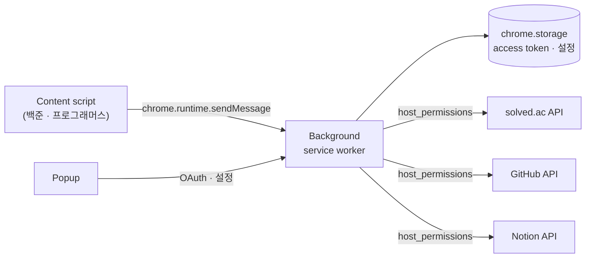

# Source Code Uploader

[English](README.md) | **한국어**

알고리즘 문제 사이트에서 통과한 소스 코드를 **버튼 한 번으로 GitHub · Notion에 업로드**하는 Chrome 확장 프로그램이에요. 별도 서버도, 토큰 직접 설정도 필요 없어요.

<!-- TODO: 데모 GIF (프로그래머스 문제 페이지 → 업로드 버튼 → GitHub 커밋 / Notion 페이지) -->

> **참고** — 백준 온라인 저지가 서비스를 종료했어요. 아래 백준 기능은 종료 전까지 만들어 쓰던 기능이고, 지금은 동작을 확인할 수 없어요. 현재는 프로그래머스를 지원해요.

## 기능

- **원클릭 업로드** — 맞은 제출에 GitHub / Notion 업로드 버튼을 붙여요.
- **자동 업로드** — 켜 두면 제출 결과가 *맞았습니다*로 바뀌는 순간 자동으로 올려요.
- **GitHub** — 선택한 저장소의 `{플랫폼}/{문제}.{확장자}`에 커밋해요. 내용이 같으면 커밋하지 않아요.
- **Notion** — 선택한 데이터베이스에 문제 제목 · 난이도 · 태그를 속성으로, 소스 코드를 코드 블록으로 담은 페이지를 만들어요.
- **문제 정보** — [solved.ac](https://solved.ac)에서 제목 · 난이도 · 태그를 가져와요.
- **OAuth 로그인** — 팝업에서 GitHub · Notion에 로그인하고, 목록에서 저장소 · 데이터베이스를 골라요.
- **다크 모드** — 업로드 아이콘이 사이트 테마를 따라가요.

## 지원 플랫폼

| 사이트 | 페이지 | GitHub | Notion | 자동 업로드 | 상태 |
|---|---|:-:|:-:|:-:|---|
| [프로그래머스](https://school.programmers.co.kr/) | 문제 풀이 페이지 | ✅ | ✅ | ✅ (채점 결과 창) | 지원 중 |
| 백준 온라인 저지 | 채점 현황(`/status`), 소스 코드(`/source/{id}`) | ✅ | ✅ | ✅ (채점 현황) | 사이트 종료 — 확인 불가 |

## 설치

아직 Chrome 웹 스토어에 등록되지 않아서 직접 불러와야 해요.

1. 이 저장소를 내려받거나 clone해요.
2. `chrome://extensions/`(**Chrome › 설정 › 확장 프로그램**)를 열어요.
3. 오른쪽 위 **개발자 모드**를 켜요.
4. **압축해제된 확장 프로그램을 로드합니다**를 누르고 저장소 폴더(`manifest.json`이 있는 폴더)를 선택해요.

## 사용 방법

1. 확장 프로그램 아이콘을 눌러 팝업을 열어요.
2. **GitHub** — `Authorize`를 누르고 접근을 허용한 뒤, 업로드할 저장소를 골라요. ([가이드](scripts/github/README.md))
3. **Notion** — `Authorize`를 누르고 데이터베이스가 있는 페이지에 접근을 허용한 뒤, 데이터베이스를 골라요. ([가이드](scripts/notion/README.md))
4. (선택) 플랫폼별 **자동 업로드**를 켜요.
5. 문제를 풀어요. 프로그래머스 문제 풀이 페이지에서 GitHub 또는 Notion 업로드 버튼을 누르거나, 자동 업로드를 켜 두면 정답일 때 바로 올라가요.
   (백준에서는 채점 현황의 맞은 제출에 업로드 버튼이 생기고, 자동 업로드도 할 수 있었어요.)

## 동작 방식



- **Content script**가 문제 페이지에서 문제 · 언어 · 제출 정보를 파싱하고 업로드 버튼을 그려요.
- **Background service worker**가 모든 네트워크 요청을 맡아요. `host_permissions` 덕분에 GitHub · Notion · solved.ac API를 CORS 문제 없이 호출할 수 있어서 서버가 필요 없어요.
- **프로그래머스**는 코드가 페이지의 에디터 객체 안에만 있는데, 분리된 환경에서 도는 content script는 이걸 읽을 수 없어요. 그래서 `scripts/programmers/sourceExtractor.js`를 페이지 컨텍스트에 주입하고 `window.postMessage`로 코드를 받아 와요.
- **백준 소스 코드 다운로드**는 `declarativeNetRequest`(`rules.json`)로 사이트가 요구하는 요청 헤더를 맞춰요.

### 권한

| 권한 | 이유 |
|---|---|
| `storage` | access token, 선택한 저장소 · 데이터베이스, 옵션 저장 |
| `activeTab`, `scripting` | 현재 보고 있는 문제 페이지에서 동작 |
| `declarativeNetRequest` | 백준 소스 코드를 가져올 때 요청 헤더 조정 |
| 호스트: `api.notion.com`, `github.com`, `solved.ac`, `acmicpc.net`, `programmers.co.kr` | API 호출, 문제 페이지에서 실행 |

## 프로젝트 구조

```text
├─ manifest.json
├─ rules.json               # declarativeNetRequest 규칙
├─ popup/                   # 팝업 UI (html · css · js)
└─ scripts/
   ├─ background.js         # service worker, 메시지 라우팅
   ├─ boj/                  # 백준 content script (파싱 · 버튼 · 자동 업로드)
   ├─ programmers/          # 프로그래머스 content script + 페이지 컨텍스트 추출기
   ├─ github/               # OAuth, 저장소 목록, 커밋
   ├─ notion/               # OAuth, 데이터베이스 목록, 페이지 · 블록 생성
   ├─ solvedAC/             # 문제 정보
   └─ common/               # 예외, chrome · fetch · 인코딩 유틸
```

## 개발

```bash
npm install
npm run lint            # 린트 (airbnb-base + prettier)
npm run lint:fix        # 자동 수정 가능한 린트 오류 고치기
npm run format:check    # 포맷 검사 (prettier)
npm run format          # prettier로 포맷 적용
npm test                # 단위 테스트 (node:test)
```

파일을 고친 뒤에는 `chrome://extensions/`의 확장 프로그램 카드에서 **새로고침**을 눌러요.

컨벤션: `master`에서 브랜치를 따서 PR을 열어요. 커밋 메시지는 영어 동사로 시작하고 PR 번호로 끝내요(예: `Refactor notion (#177)`). `-s`로 서명을 남겨요.

## 변경 이력

| 버전 | 기간 | 구조 |
|---|---|---|
| v1 | 2022.01 – 02 | 내려받은 파일을 감지해 `.env` 토큰으로 업로드하는 로컬 Python 스크립트 |
| v2 | 2022.12 – 2023.01 | Extension + Django REST 서버(Docker · Nginx · Jenkins) — 스냅샷: [`before_remove_server`](https://github.com/Seojeonguk/sourceCodeUploader/tree/before_remove_server) |
| v3 | 2024.02 – | OAuth를 쓰는 서버 없는 Extension ([#102](https://github.com/Seojeonguk/sourceCodeUploader/issues/102), [#105](https://github.com/Seojeonguk/sourceCodeUploader/pull/105)) |
| v3.x | 2024.07 – 2026.04 | 채점 현황 업로드, Notion 길이 제한, UTF-8 인코딩, 리팩토링, 프로그래머스, 자동 업로드 |
| v3.x | 2026.10 | 프로그래머스 Notion 업로드 · 자동 업로드, 페이지 안 메시지, lint · 테스트 CI |

## 문의

버그를 찾았거나 아이디어가 있다면 [이슈를 남겨 주세요](https://github.com/Seojeonguk/sourceCodeUploader/issues).
