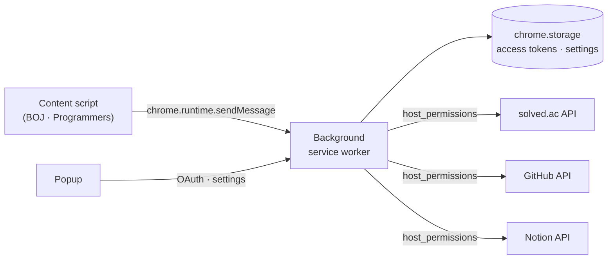

# Source Code Uploader

**English** | [한국어](README.ko.md)

A Chrome extension that uploads your accepted solutions from algorithm judge sites to **GitHub** and **Notion** with a single click — no server, no manual token setup.

<!-- TODO: demo GIF (Programmers problem page → upload button → GitHub commit) -->

> **Note** — Baekjoon Online Judge has been shut down. The BOJ features below were built and used until then, but can no longer be tested. Programmers is currently supported.

## Features

- **One-click upload** — Adds GitHub / Notion upload buttons to your accepted submissions.
- **Auto upload** — Optionally uploads automatically as soon as a submission turns *Accepted*.
- **GitHub** — Commits the source to `{platform}/{problem}.{ext}` in the repository you choose. Skips the commit if the file content is unchanged.
- **Notion** — Creates a page in the database you choose, with the problem title, level and tags as properties and the source as a code block.
- **Problem info** — Fetches title, level and tags from [solved.ac](https://solved.ac).
- **OAuth login** — Sign in with GitHub and Notion from the popup; pick a repository or database from a list.
- **Dark mode** — Upload icons follow the site theme.

## Supported Platforms

| Source | Pages | GitHub | Notion | Auto upload | Status |
|---|---|:-:|:-:|:-:|---|
| [Programmers](https://school.programmers.co.kr/) | Lesson page | ✅ | — | — | Supported |
| Baekjoon Online Judge | Status (`/status`), Source (`/source/{id}`) | ✅ | ✅ | ✅ (status page) | Site shut down — untested |

## Installation

The extension is not on the Chrome Web Store yet. Load it manually:

1. Download or clone this repository.
2. Open `chrome://extensions/` (**Chrome › Settings › Extensions**).
3. Turn on **Developer mode** (top right).
4. Click **Load unpacked** and select the repository folder (the one containing `manifest.json`).

## Usage

1. Click the extension icon to open the popup.
2. **GitHub** — Click `Authorize`, approve access, then select the repository to upload to. ([guide](scripts/github/README.md))
3. **Notion** — Click `Authorize`, allow access to the page that contains your database, then select the database. ([guide](scripts/notion/README.md))
4. (Optional) Turn on **Auto upload** for each platform.
5. Solve a problem. On a Programmers lesson page, click the GitHub upload button.
   (On BOJ, accepted submissions on the status page got upload buttons and could be uploaded automatically.)

## How It Works



- **Content scripts** parse the judge page (problem, language, submission) and render the upload buttons.
- **The background service worker** does every network call. Thanks to `host_permissions`, it can call the GitHub, Notion and solved.ac APIs without CORS issues — which is why no server is needed.
- **Programmers** keeps the code inside the page's editor object, which the isolated content script cannot read. `scripts/programmers/sourceExtractor.js` is injected into the page context and returns the code via `window.postMessage`.
- **BOJ source download** uses `declarativeNetRequest` (`rules.json`) to set the request headers the site expects.

### Permissions

| Permission | Why |
|---|---|
| `storage` | Keep access tokens, the selected repository / database and options |
| `activeTab`, `scripting` | Work with the judge page you are on |
| `declarativeNetRequest` | Adjust request headers when fetching BOJ source code |
| Host: `api.notion.com`, `github.com`, `solved.ac`, `acmicpc.net`, `programmers.co.kr` | Call the APIs and run on the judge pages |

## Project Structure

```text
├─ manifest.json
├─ rules.json               # declarativeNetRequest rules
├─ popup/                   # popup UI (html · css · js)
└─ scripts/
   ├─ background.js         # service worker, message routing
   ├─ boj/                  # BOJ content scripts (parsing, buttons, auto upload)
   ├─ programmers/          # Programmers content script + page-context extractor
   ├─ github/               # OAuth, repository list, commit
   ├─ notion/               # OAuth, database list, page / block builders
   ├─ solvedAC/             # problem info
   └─ common/               # exceptions, chrome / fetch / encoding utils
```

## Development

```bash
npm install
npm run lint            # eslint (airbnb-base + prettier)
npm run lint:fix        # fix auto-fixable lint errors
npm run format:check    # prettier check
npm run format          # format with prettier
npm test                # unit tests (node:test)
```

After changing files, click **Reload** on the extension card in `chrome://extensions/`.

Conventions: branch from `master` and open a PR; commit messages start with an English verb and end with the PR number, e.g. `Refactor notion (#177)`, signed off with `-s`.

## History

| Version | Period | Architecture |
|---|---|---|
| v1 | 2022.01 – 02 | Local Python script watching downloaded files, uploading via `.env` tokens |
| v2 | 2022.12 – 2023.01 | Extension + Django REST server (Docker · Nginx · Jenkins) — snapshot: [`before_remove_server`](https://github.com/Seojeonguk/sourceCodeUploader/tree/before_remove_server) |
| v3 | 2024.02 – | Serverless extension with OAuth ([#102](https://github.com/Seojeonguk/sourceCodeUploader/issues/102), [#105](https://github.com/Seojeonguk/sourceCodeUploader/pull/105)) |
| v3.x | 2024.07 – 2026.04 | Status-page upload, Notion length limits, UTF-8 encoding, refactoring, Programmers, auto upload |

## Support

Found a bug or have an idea? [Open an issue](https://github.com/Seojeonguk/sourceCodeUploader/issues).
