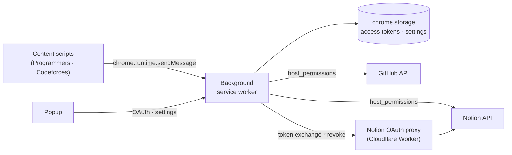

# Source Code Uploader

**English** | [한국어](README.ko.md)

A Chrome extension that uploads your accepted solutions from algorithm judge sites to **GitHub** and **Notion** with a single click — no server, no manual token setup.


> **Note** — Baekjoon Online Judge has been shut down, so its support was removed. The last version with it is kept at the [`before_remove_boj`](https://github.com/Seojeonguk/sourceCodeUploader/tree/before_remove_boj) tag.

## Features

- **One-click upload** — Adds GitHub / Notion upload buttons to your accepted submissions.
- **Auto upload** — Optionally uploads automatically as soon as a submission turns *Accepted*.
- **GitHub** — Commits the source to `{platform}/{problem}.{ext}` in the repository you choose. Skips the commit if the file content is unchanged.
- **Notion** — Creates a page in the database you choose, with the problem title, level and tags as properties and the source as a code block.
- **Login** — Sign in with GitHub (device code) and Notion (OAuth) from the popup; pick a repository or database from a list. No client secret is shipped in the extension, and the GitHub token reaches only the repositories you install the GitHub App on.

## Supported Platforms

| Source | Pages | GitHub | Notion | Auto upload | Status |
|---|---|:-:|:-:|:-:|---|
| [Programmers](https://school.programmers.co.kr/) | Lesson page | ✅ | ✅ | ✅ (result modal) | Supported |
| [Codeforces](https://codeforces.com/) | Your accepted submission | ✅ | ✅ | ✅ (status page) | Turn it on in the popup |

## Installation

Install it from the **[Chrome Web Store](https://chromewebstore.google.com/detail/source-code-uploader/kgpilkohekdjpfpcckdlnlolddiheijn)**. It needs Chrome 116 or later, and the store keeps it up to date.

### Load unpacked (for development)

1. Download or clone this repository.
2. Open `chrome://extensions/` (**Chrome › Settings › Extensions**).
3. Turn on **Developer mode** (top right).
4. Click **Load unpacked** and select the repository folder (the one containing `manifest.json`).

The store version has its own extension ID, separate from the unpacked one, so each keeps its own logins and settings. Moving from the unpacked copy to the store version means logging in to GitHub and Notion and selecting the repository and database again; then remove the unpacked copy.

## Usage

1. Click the extension icon to open the popup.
2. **GitHub** — On the **GitHub** tab, click `Log in`. A login page shows a code: enter it on GitHub and approve access. Install the GitHub App on the repositories to upload to (`+ Add repositories` in the repository list), then choose one in **Select a repository**. ([guide](scripts/github/README.md))
3. **Notion** — On the **Notion** tab, click `Log in`, allow access to the page that contains your database, then choose the database in **Select a database**. The extension adds the properties it needs to the database ([guide](scripts/notion/README.md#prepare-the-database)).
4. (Optional) Turn on **Upload automatically when accepted** on each tab. A tab shows ✓ when it is ready.
5. Solve a problem. On a Programmers lesson page, click the GitHub or Notion upload button, or turn on auto upload to upload when the result is accepted.
6. (Codeforces) Turn on Codeforces under **Problem sites** in the popup, and allow the access Chrome asks for. The upload buttons are above the code of your accepted submission, and with auto upload on, a submission accepted while `/contest/<id>/my` or `/submissions/<handle>` is open is uploaded.

## How It Works



- **Content scripts** parse the judge page (problem, language, submission) and render the upload buttons.
- **The background service worker** does every network call. Thanks to `host_permissions`, it can call the GitHub and Notion APIs without CORS issues — which is why no server is needed.
- **Programmers** keeps the code inside the page's editor object, which the isolated content script cannot read. `scripts/programmers/sourceExtractor.js` is injected into the page context and returns the code via `window.postMessage`.
- **Optional judge sites** — A new site is not added to `host_permissions`, because a new required permission would disable the store extension for existing users until they accept it. Sites are listed in `scripts/judgeSites.js`; an optional one, such as Codeforces, is in `optional_host_permissions`. Turning it on in the popup asks Chrome for its host, and `scripts/sitePermissions.js` then registers its content script with `chrome.scripting.registerContentScripts` (and unregisters it when the permission is removed).
- **Codeforces** shows the code of a submission in the page, so its content script reads it directly. The problem name, rating and tags come from the problem page, and auto upload reads the submission page of a row that turns accepted on the status page; both are same-origin requests in the user's session.
- **Secrets** — GitHub logs in to a GitHub App with the device flow, which needs only the client ID; its token expires after 8 hours, is refreshed without the client secret, and reaches only the repositories the App is installed on. Notion needs the client secret to exchange the code, so a small worker in `proxy/notion-oauth/` keeps it. The Notion login opens in a window from `chrome.identity.launchWebAuthFlow`, which catches the redirect to `https://<extension-id>.chromiumapp.org/`, so the code never reaches another site, and the redirect is accepted only with the `state` sent for that login.
- **Messages and storage** — The background accepts only the upload messages (`commit`, `upload`, and reading the auto upload option) from the judge pages, and every other message only from the extension's own pages (`scripts/senders.js`). `chrome.storage.local`, which keeps the access tokens, is hidden from content scripts, and the uploaded path takes only a known platform folder and file extension.

### Permissions

| Permission | Why |
|---|---|
| `identity` | Open the Notion login window and receive its redirect |
| `storage` | Keep access tokens, the selected repository / database and options |
| `scripting` | Run the scripts of an optional judge site after you turn it on in the popup |
| Optional host: `codeforces.com` | Run on Codeforces, asked for only when you turn it on in the popup |
| Host: `api.notion.com`, `github.com`, `programmers.co.kr` | Call the APIs and run on the judge pages |

What the extension reads, sends and keeps is in the [privacy policy](PRIVACY.md).

## Project Structure

```text
├─ manifest.json
├─ _locales/                # messages in English (default) and Korean
├─ popup/                   # popup UI and the GitHub login page (html · css · js)
├─ proxy/notion-oauth/      # Cloudflare Worker that keeps the Notion client secret
├─ tools/                   # packages the zip for the Chrome Web Store
└─ scripts/
   ├─ background.js         # service worker, message routing
   ├─ senders.js            # checks who sent a message (extension page / judge page)
   ├─ judgeSites.js         # judge sites (required / optional)
   ├─ sitePermissions.js    # registers the content scripts of the optional sites that are turned on
   ├─ content/              # shared UI of the optional sites' content scripts (buttons · messages)
   ├─ programmers/          # Programmers content script + page-context extractor
   ├─ codeforces/           # Codeforces content script
   ├─ github/               # device flow login, repository list, commit
   ├─ notion/               # OAuth (through the proxy), database list, page / block builders
   └─ common/               # exceptions, chrome / fetch / encoding utils
```

## Development

Requires Node.js 22.22.2+ or 24.15.0+ (`engines` in `package.json`; CI uses Node 22).

```bash
npm install
npm run lint            # eslint 10 (recommended + airbnb-base rules + prettier)
npm run lint:fix        # fix auto-fixable lint errors
npm run format:check    # prettier check
npm run format          # format with prettier
npm test                # unit tests (node:test)
npm run package         # zip for the Chrome Web Store (dist/)
```

After changing files, click **Reload** on the extension card in `chrome://extensions/`.

The `key` in `manifest.json` fixes the extension ID to `mfhbpmbchemfhijjamldbkidlegfmaff` wherever the folder is loaded from, so the deployed [Notion OAuth proxy](proxy/notion-oauth/README.md) accepts everyone's login. Users do not deploy anything; the maintainer deploys the proxy once and keeps its URL in `TOKEN_PROXY_URL` of `scripts/notion/config/config.js`.

The texts the user sees are in `_locales/en/messages.json` and `_locales/ko/messages.json`, shown in the language of Chrome. Use `t('key')` from `scripts/common/utils/i18n.js` in scripts and `data-i18n="key"` in the extension pages, and add each new message to both files; a test checks that they match.

Publishing on the Chrome Web Store: [docs/chrome-web-store.md](docs/chrome-web-store.md).

Conventions: branch from `master` and open a PR; commit messages start with an English verb and end with the PR number, e.g. `Refactor notion (#177)`, signed off with `-s`.

## History

| Version | Period | Architecture |
|---|---|---|
| v1 | 2022.01 – 02 | Local Python script watching downloaded files, uploading via `.env` tokens |
| v2 | 2022.12 – 2023.01 | Extension + Django REST server (Docker · Nginx · Jenkins) — snapshot: [`before_remove_server`](https://github.com/Seojeonguk/sourceCodeUploader/tree/before_remove_server) |
| v3 | 2024.02 – | Serverless extension with OAuth ([#102](https://github.com/Seojeonguk/sourceCodeUploader/issues/102), [#105](https://github.com/Seojeonguk/sourceCodeUploader/pull/105)) |
| v3.x | 2024.07 – 2026.04 | Status-page upload, Notion length limits, UTF-8 encoding, refactoring, Programmers, auto upload |
| v3.x | 2026.10 | Programmers Notion upload and auto upload, in-page messages, lint · test CI |
| v3.x | 2026.10 | Baekjoon support removed after the site shut down — snapshot: [`before_remove_boj`](https://github.com/Seojeonguk/sourceCodeUploader/tree/before_remove_boj) |
| v3.x | 2026.10 | Chrome Web Store, Korean, Notion properties added automatically, popup as setup steps, Codeforces as the first optional judge site |

## Support

Found a bug or have an idea? [Open an issue](https://github.com/Seojeonguk/sourceCodeUploader/issues).
