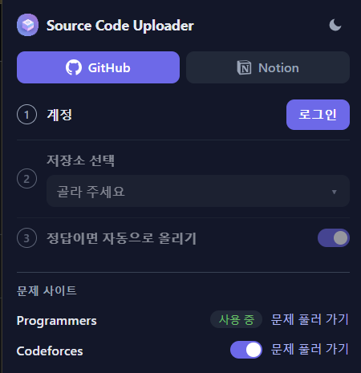
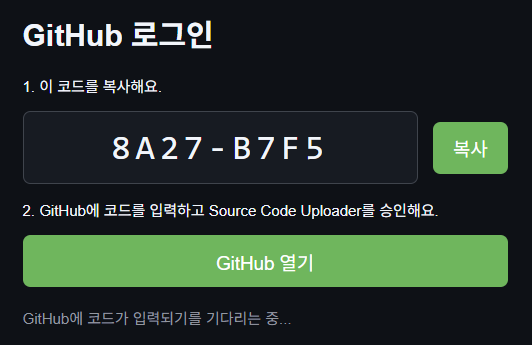
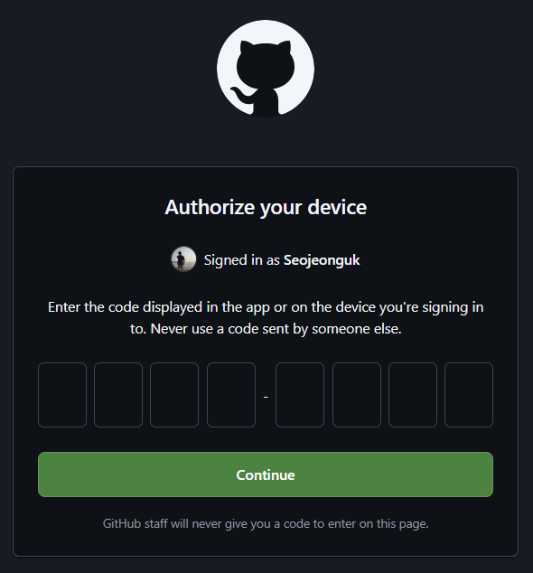
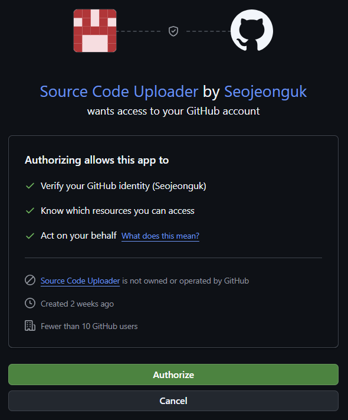
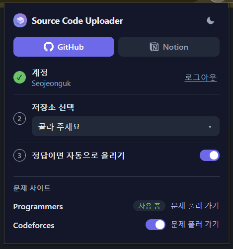
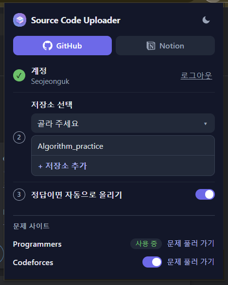

# Usage

The screenshots are from Chrome in Korean; in other languages the popup is in English.

## Table of Contents

1. [Log in](#log-in)
2. [Install the App on repositories](#install-the-app-on-repositories)
3. [Select a repository](#select-a-repository)
4. [Log out](#log-out)
5. [Commit](#commit)
6. [Auto upload](#auto-upload)

## Log in

- Open the popup and the **GitHub** tab, then click `Log in` in the **Account** step. Steps 2 and 3 stay inactive until you log in.

  

- A login page opens with a code. Click `Open GitHub`; the code is copied as well.

  

- On GitHub, paste the code and click `Continue`.

  

- Check that the app is **Source Code Uploader by Seojeonguk** and click `Authorize`. GitHub shows "Congratulations, you're all set!", and you can close that tab.

  

- The login page shows that you are logged in and closes automatically.
- The **Account** step shows ✓ and your GitHub user name, and the button changes to `Log out`. The popup updates even if it was open during the login.

  

The extension logs in to the **Source Code Uploader GitHub App** with the [device flow](https://docs.github.com/en/apps/creating-github-apps/authenticating-with-a-github-app/generating-a-user-access-token-for-a-github-app#using-the-device-flow-to-generate-a-user-access-token), which needs only the client ID, so no client secret is shipped in the extension. **Enable Device Flow** must be turned on in the settings of the GitHub App.

The token can only reach the repositories you install the App on, with the App's **Contents (read and write)** permission. It expires after 8 hours, and the extension refreshes it with the refresh token (valid for 6 months) without the client secret.

If you logged in with the old OAuth App (access to every repository), the extension asks you to log in again. Revoke the old **Source Code Uploader** OAuth App on the [authorized OAuth apps page](https://github.com/settings/applications).

## Install the App on repositories

- The repository list shows only your repositories that the App is installed on.
- Click `+ Add repositories` at the end of the list (or open the App's install page), choose **Only select repositories**, and select the repositories to upload to.
- Open the list again to see them.

## Select a repository

- In the **Select a repository** step, click `Choose…`. The list of repositories opens below it.
- Select the repository to upload to. Its name is shown in the step.

  

- When the login and the repository are set, the **GitHub** tab shows ✓ and the popup says "Ready! Click the upload button on a problem page."

## Log out

- Click `Log out` in the **Account** step of the **GitHub** tab. The saved login and repository are removed.
- GitHub cannot revoke a token without the client secret, so the [authorized GitHub Apps page](https://github.com/settings/apps/authorizations) opens. Revoke Source Code Uploader there if you want to remove the access on GitHub as well. To remove the App from repositories, uninstall it on the [installed GitHub Apps page](https://github.com/settings/installations).

## Commit

### Programmers

- Open a problem on [Programmers](https://school.programmers.co.kr/) and write your solution.
- Click the GitHub icon button at the top right of the code editor.
- The source code is committed to `Programmers/{problem title}.{extension}` in the selected repository.

### Codeforces

- Turn on `Use Codeforces` under **Problem sites** in the popup, and allow the access Chrome asks for.
- Open your accepted submission, such as `https://codeforces.com/contest/1850/submission/<id>`.
- Click the GitHub icon button above the code.
- The source code is committed to `Codeforces/{problem ID} - {problem name}.{extension}`, such as `Codeforces/1850F - We Were Both Children.cpp`.

### Both sites

- If the commit is successful, a message with an `Open` link to the uploaded file is shown at the bottom right of the page.
- If the same source code has already been uploaded, it is not committed again and a message says so. (The source code must match exactly.)
- If an error occurs, the cause of the error is shown in the message.

## Auto upload

- Turn on `Upload automatically when accepted` in the **GitHub** tab of the popup.
- Programmers: when the result of `제출 후 채점하기` is `정답`, the source code is committed without clicking the button.
- Codeforces: while your status page (`/contest/<id>/my` or `/submissions/<handle>`) is open, a submission that becomes accepted is committed once. Submissions that were already accepted when the page opened are left alone.
