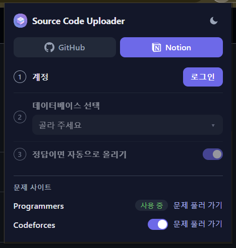
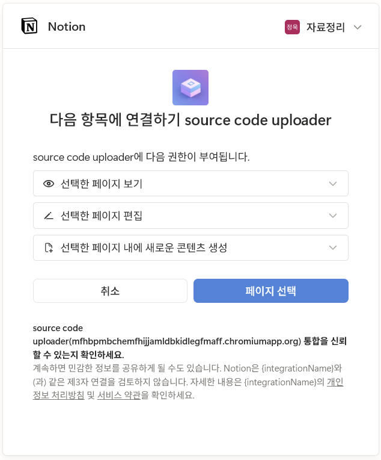
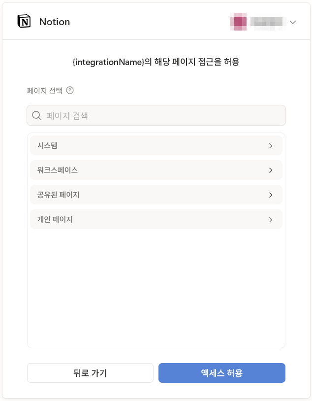
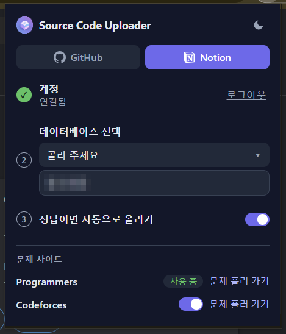

# Usage

The screenshots are from Chrome in Korean; in other languages the popup is in English.

## Table of Contents

1. [Prepare the database](#prepare-the-database)
2. [Log in](#log-in)
3. [Select a database](#select-a-database)
4. [Log out](#log-out)
5. [Uploading](#uploading)
6. [Auto upload](#auto-upload)

## Prepare the database

Any Notion database works, even an empty one. When you select it in the popup, the extension adds the properties below that it does not have, and the popup names the added ones. A database selected before this version gets them at its first upload: Notion rejects the upload, the extension adds the missing properties and uploads once more.

The names are case-sensitive. If the database already has a property with one of these names but another type, such as `URL` as Text, nothing is added and the popup names the property: change its type, or rename it so the extension can add its own.

| Property | Type         | Value                                                                                                                                                 |
| -------- | ------------ | ----------------------------------------------------------------------------------------------------------------------------------------------------- |
| (title)  | Title        | The problem title. The title property can have any name.                                                                                              |
| `info`   | Multi-select | The platform, level and problem ID, such as `Programmers`, `Lv. 2`, `42586`, or `Codeforces`, `Rating 1300`, `1850F`, or `JUNGOL`, `Bronze V`, `1000` |
| `tags`   | Multi-select | The categories of the problem: from the breadcrumb on Programmers, and the problem tags on Codeforces and JUNGOL                                      |
| `URL`    | URL          | The problem URL. Used to find a problem that was already uploaded.                                                                                    |
| `Date`   | Date         | The date of the last upload                                                                                                                           |
| `mime`   | Select       | The file extension of the source code, such as `py`                                                                                                   |

- Select and multi-select options are added by Notion automatically, so you do not need to create them.
- Other properties are left as they are, so you can add your own, such as a status or notes.
- The page body has a `How to resolve?` heading for your notes and a `Source Code` heading with the code block. When the same problem is uploaded again, only the code block below `Source Code` and the `Date` and `mime` properties are changed.

## Log in

- Open the popup and the **Notion** tab, then click `Log in` in the **Account** step to grant access to Notion.

  

- A Notion window opens. Check the workspace at the top right, and click `Select pages`.

  

- Select the page that contains the database to upload to, and click `Allow access`.

  

- Once authorized, the login window closes automatically.
- The popup closes while the login window is open. If the login fails, such as when you cancel the access or close the window, the popup shows the reason the next time you open it. Click `Log in` again.
- The **Account** step shows ✓ and `Connected`, and the button changes to `Log out`.

## Select a database

- In the **Select a database** step, click `Choose…`. A spinner shows while the databases of the pages you gave access to load, then the list opens below it.
- Select the database to upload to. Its name is shown in the step, and the popup names the properties it added to the database.

  

  - A database with more than one data source is listed once for each data source; select the one to upload to.
  - If you selected a database before this version, it is moved to its data source on the next upload. If the database has more than one data source, you are asked to select it again.

- When the login and the database are set, the **Notion** tab shows ✓ and the popup says "Ready! Click the upload button on a problem page."

## Log out

- Click `Log out` in the **Account** step of the **Notion** tab. The login is revoked on Notion, and the saved login and database are removed.

## Uploading

- Programmers: open a problem on [Programmers](https://school.programmers.co.kr/), write your solution, and click the Notion icon button at the top right of the code editor.
- Codeforces: turn on `Use Codeforces` under **Problem sites** in the popup, open your accepted submission, and click the Notion icon button above the code.
- JUNGOL: turn on `Use JUNGOL` under **Problem sites** in the popup, and submit your solution on a problem page. When the judge accepts it, click the Notion icon button in the panel at the bottom left of the page.
- A page with the problem title, level and tags as properties and the source code as a code block is created in the selected database.
- If the problem has already been uploaded, the source code of that page is replaced instead of creating a new page. If the source code is the same, nothing is changed and a message says so.
- If the upload is successful, a message with an `Open` link to the Notion page is shown at the bottom right of the page.
- If an error occurs, the cause of the error is shown in the message.

## Auto upload

- Turn on `Upload automatically when accepted` in the **Notion** tab of the popup.
- Programmers: when the result of `제출 후 채점하기` is `정답`, the source code is uploaded without clicking the button.
- Codeforces: while your status page (`/contest/<id>/my` or `/submissions/<handle>`) is open, a submission that becomes accepted is uploaded once.
- JUNGOL: not yet; use the buttons in the panel ([#279](https://github.com/Seojeonguk/sourceCodeUploader/issues/279)).
